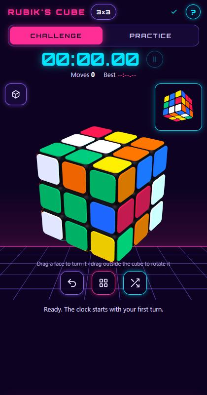
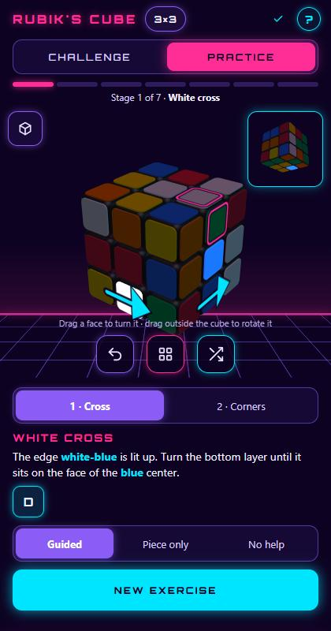

<div align="center">

# 🟥🟩🟦 CUBO RUBIK · byarcy

**Cubo Rubik interactivo en 3D, hecho para el celular y con estilo synthwave.**

Mide tu tiempo en el modo Reto y aprende el método por capas, etapa por etapa, en el modo Práctica.

[English](README.md) · [Español](README.es.md)

### [▶ Abrir la app](https://byarcy.github.io/cubo-rubik/)

`https://byarcy.github.io/cubo-rubik/`


</div>

<p align="center">
  
  &nbsp;
  
</p>
<p align="center"><sub>Reto con temporizador · Práctica guiada, etapa por etapa (capturas en inglés)</sub></p>

> **Desde la versión 0.30 la app está reescrita desde cero**, y desde la 0.34 todo el proyecto (código, comentarios,
> nombres de archivos y documentación) está en inglés, con los textos de la interfaz en archivos de traducción planos (`locales/`).
> El modo Práctica trae por ahora tres lecciones (las dos primeras capas); las demás están en camino (ver
> [TODO.md](TODO.md), en inglés). La versión anterior quedó guardada en la etiqueta `v0.21`.

---

## ✨ Qué puedes hacer

### ⏱️ Reto
Mezcla el cubo y resuélvelo contra el reloj. El tiempo empieza con tu primer giro, cuenta tus movimientos y guarda tu mejor marca. Puedes pausarlo.

### 🧭 Práctica
Para aprender el **método por capas**, el de principiantes, dividido en 7 etapas.

- **Barra de etapas:** la app mira tu cubo y muestra cuántas etapas llevas completas y cuál toca.
- **Lección 1 · Cruz blanca:** parte de un cubo mezclado y enseña una receta que siempre funciona: llevar la arista a la capa amarilla, girarla hasta la cara de su color y meterla con media vuelta.
- **Lección 2 · Esquinas blancas:** cada ejercicio empieza con la cruz ya hecha y varias esquinas fuera de sitio.
- **Lección 3 · Segunda capa:** empieza con la capa blanca hecha. Cada arista del medio sube desde la capa amarilla: giras esa capa hasta dejar la arista debajo del centro de su color del costado, y entra hacia la derecha o hacia la izquierda con 8 giros. Si una arista está en la capa del medio pero mal puesta o volteada, esos mismos 8 giros primero la bajan.
- **Blanco arriba:** como en las guías, el cubo se muestra con el blanco arriba. Gira solo para dejar de frente las caras que toca mover, pero respeta la vista que tú elijas con los dedos o con el botón del cubo. Para la capa de abajo, que no se ve desde arriba, la flecha se pega en la fila de abajo de las caras visibles.
- **Pieza en foco:** la pieza que toca se ilumina y el resto del cubo se atenúa. Un marco rosa señala su hueco.
- **Flecha sobre el cubo:** la cara que debes girar muestra una flecha con el sentido del giro, y debajo aparecen los giros en letras para ir aprendiendo la notación.
- **Te corrige, sin castigar rutas válidas:** si giras otra cara a mitad de un paso, te pide deshacerla. Pero si el paso se puede resolver por otro camino igual de bueno (girar la capa al otro lado, o tratar una pieza de la diagonal por la cara de al lado), lo acepta y sigue contigo por ese camino.
- **Tres niveles de ayuda:** *Guiado* (pieza, hueco, flecha y giros), *Solo la pieza* (pieza y hueco, sin giros) y *Sin ayuda* (solo te avisa cuando la capa está completa).

#### Las 7 etapas

| # | Etapa | Lección |
| --- | --- | --- |
| 1 | Cruz blanca | ✅ Lista |
| 2 | Esquinas blancas | ✅ Lista |
| 3 | Segunda capa | ✅ Lista |
| 4 | Cruz amarilla | En construcción |
| 5 | Aristas amarillas | En construcción |
| 6 | Esquinas amarillas en su sitio | En construcción |
| 7 | Esquinas amarillas giradas | En construcción |

### 🌍 Idiomas
Por ahora, inglés y español. La app toma el idioma de tu navegador (inglés si no tiene el tuyo) y lo puedes cambiar en **Ayuda**. Agregar un idioma es agregar un archivo de traducción: ver [Agregar un idioma](#agregar-un-idioma).

### 🧊 Cubo 2×2
Botón junto al título para cambiar entre 3×3 y 2×2 en el Reto. Cada tamaño guarda su propio cubo, tiempo y récord. La Práctica usa el 3×3.

### Y además
- Gira las caras arrastrando con el dedo, o usa el menú **GIROS** con la notación (R, U', F2…).
- Arrastra fuera del cubo para girarlo entero. Con dos dedos, moverlos gira el cubo y rotarlos lo gira en la pantalla, como una perilla, desde cualquier posición; el recuadro de la esquina muestra el lado que no ves.
- Ayuda con el uso de la app y la notación.
- Tu avance se guarda solo, en tu navegador (el avance guardado por versiones anteriores se conserva).
- Hay un secreto escondido para quien resuelva el cubo. 😉

---

## 📲 Instalarla en el celular

Funciona en el navegador y también se puede **instalar como app**. Una vez instalada, abre sin conexión.

| Android (Chrome) | iPhone (Safari) |
| --- | --- |
| Abre la app → menú **⋮** → **Instalar app** o **Agregar a la pantalla principal** | Abre la app → **Compartir** → **Agregar a inicio** |

---

## 🛠️ Cómo está hecha

- **Sin librerías:** HTML, CSS y JavaScript puros. No hay que compilar nada.
- **Motor 3D propio** sobre WebGL, que dibuja solo cuando algo se mueve, para cuidar la batería.
- **Lógica separada del dibujo:** el estado del cubo y el entrenador no conocen la interfaz, así que se pueden probar solos.
- **Ejercicios generados:** el entrenador parte de un cubo armado, revuelve lo que la lección no usa y saca de sitio las piezas que vas a practicar. Así todos los ejercicios tienen solución.
- **Textos aparte del código:** la interfaz nunca lleva texto escrito; todo sale de `locales/` por clave. Las traducciones son JSON planos (datos, nunca código) y solo pueden usar `<b>` y `<small>`: lo demás se escapa, así que una traducción no puede meter nada en la página.
- **PWA:** `manifest.webmanifest` y un *service worker* (`sw.js`) que guarda la app para usarla sin internet.

### Contenido del repositorio

| Archivo | Qué es |
| --- | --- |
| `index.html` | La página: estructura (sus textos salen de `locales/`) |
| `styles.css` | Diseño visual |
| `graphics_engine.js` | Motor 3D (WebGL), escena, luces y animación de las capas |
| `cube_logic.js` | Estado del cubo, giros, notación y detector de etapas |
| `algorithms.js` | Secuencias de cada método, en notación estándar |
| `coach.js` | El «profe» de la Práctica: reconoce el caso, ofrece rutas equivalentes y prepara los ejercicios |
| `game_controller.js` | Entrada (dedo, botones), Reto, Práctica, guardado y bucle principal |
| `i18n.js` | Módulo de idiomas: carga las traducciones, busca los textos por clave, plurales, escape, detección del idioma |
| `locales/languages.json` | La lista de idiomas disponibles |
| `locales/en.json`, `locales/es.json` | Los textos de cada idioma (un JSON plano por idioma) |
| `sw.js` | Service worker: guarda la app para usarla sin conexión |
| `manifest.webmanifest` | Datos para instalarla como app |
| `orbitron.woff` | Fuente de los títulos |
| `icon.svg`, `icon-192.png`, `icon-512.png`, `apple-touch-icon.png` | Íconos |
| `tests/lessons.test.js` | Prueba sin navegador: resuelve cientos de ejercicios de cada lección registrada |
| `tests/i18n.test.js` | Prueba sin navegador: cada idioma está completo y es coherente |
| `TODO.md` | Lo que falta: lecciones, otros métodos e idiomas |
| `screenshots/` | Imágenes de este README |

### Probarla en tu computadora

La app carga sus textos con `fetch`, así que necesita un servidor web (abrir `index.html` como archivo no funciona). Con Python instalado:

```bash
python -m http.server 8123
```

Luego abre `http://localhost:8123`. Con `?debug=true` al final, mezclar desordena un solo giro y el avance se guarda aparte.

### Pruebas

```bash
node tests/lessons.test.js
node tests/i18n.test.js
```

La primera recorre todas las lecciones que existan, así que sirve también para las que se agreguen. La segunda recorre todos los idiomas de `locales/` y además comprueba que una traducción no pueda meter código en la página.

### Agregar un idioma

1. Copia `locales/en.json` a `locales/xx.json` (`xx` = código del idioma, por ejemplo `pt` o `fr`) y traduce los textos. Deja las claves y los `{parámetros}` tal cual; los plurales llevan las formas del idioma (`one`, `few`, `other`…); solo se permiten `<b>` y `<small>`.
2. Agrega `"xx": "Nombre del idioma"` en `locales/languages.json` y `'./locales/xx.json'` en la lista `FILES` de `sw.js`.
3. Corre `node tests/i18n.test.js`: te avisa si falta alguna clave, parámetro o archivo.

Una traducción es un archivo de datos: no hace falta programar y nunca puede ejecutar código en la app.

### Publicar una versión nueva

Cambia el número en `index.html` (`data-version`, el `<title>` y el pie), en `CACHE` de `sw.js` y en la insignia de versión de los dos README.

La página se publica con **GitHub Pages** desde la rama `main`.

---

## 🙌 Créditos

- Diseño y desarrollo: **byarcy** · © 2026
- Fuente [Orbitron](https://fonts.google.com/specimen/Orbitron), con licencia SIL Open Font License.
