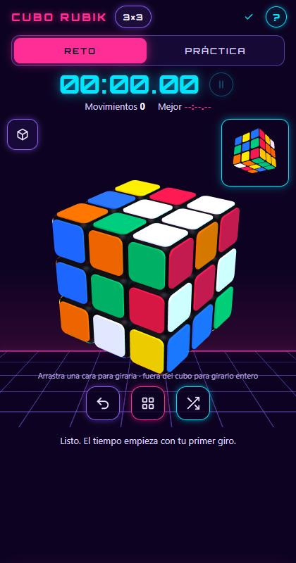
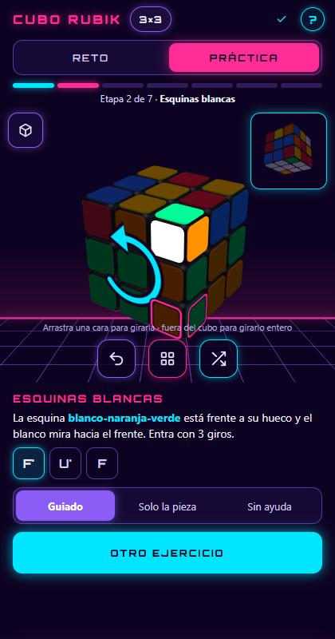
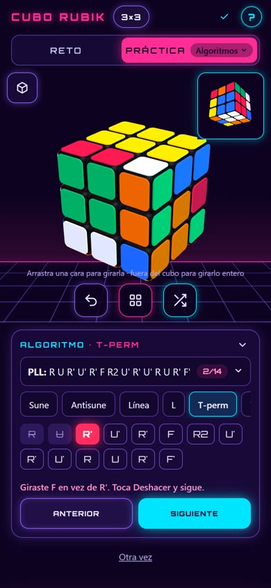

# 🟥🟩🟦 CUBO RUBIK · byarcy

**Tutorial interactivo del cubo Rubik, en español, hecho para el celular y con estilo synthwave.**

Aprende paso a paso, entrena etapas sueltas y algoritmos, y mide tu tiempo en el modo Reto.

### [▶ Abrir la app](https://byarcy.github.io/cubo-rubik/)

`https://byarcy.github.io/cubo-rubik/`

  
  &nbsp;
  
  &nbsp;
  

Reto con temporizador · Práctica guiada (solo la cruz) · Entrenador de algoritmos

---

## ✨ Qué puedes hacer

### ⏱️ Reto
Mezcla el cubo y resuélvelo contra el reloj. El tiempo empieza con tu primer giro, cuenta tus movimientos y guarda tu mejor marca.

### 🧭 Práctica guiada
La app mira tu cubo y calcula los giros exactos que te faltan, uno por uno, con un **dedo guía** que muestra hacia dónde deslizar.
- **Métodos:** Capas (el de principiantes, en 7 pasos) y CFOP (el de los speedcubers).
- **Notación interactiva:** el primer paso es un ejercicio. La app te dice una letra y tú giras esa cara; al final haces R U R' U' seis veces y el cubo vuelve a como estaba.
- **Meta de cada paso:** para qué sirve y cómo saber que terminaste. El recuadro de la esquina muestra cómo debe quedar.
- **Pieza fantasma:** en Caso, la pieza que vas a mover aparece sola un momento en su lugar final.
- **Alinear y algoritmo por separado:** los giros se agrupan, por ejemplo «Alinear: U'» + «Sune: R U R' U R U2 R'», para que entiendas por qué haces cada uno.
- **Tres niveles de ayuda:** *Guía* (todos los giros y el dedo guía), *Caso* (qué pieza mover y qué algoritmo usar, sin letras) y *Examen* (solo la meta). En los dos últimos, «💡 Dame una pista»: el primer toque vuelve a mostrar la pieza fantasma y el segundo te da el giro que sigue.
- **⏪ VOLVER:** si desarmas un paso que ya tenías listo, deshace de una vez los giros desde el error.

### 🎯 Etapas sueltas
No siempre quieres resolver desde cero:
- **🎯 Practicar solo este paso:** en cualquier paso, la app arma un caso nuevo de ese paso con todo lo anterior ya resuelto, para repetirlo las veces que quieras.
- **Solo la cruz:** lo que no es de la cruz se ve gris. Al terminar sabes si usaste la menor cantidad de giros posible.
- **Solo la última capa:** empiezas con las dos primeras capas ya armadas y practicas OLL y PLL.

### 🧠 Entrenador de algoritmos
Elige un algoritmo (Sune, Antisune, T-perm, Y-perm, Ua, Ub, Aa, Ab…) y la app arma su caso. Lo haces giro por giro: la letra que toca se ilumina y, **si giras una cara equivocada, se marca en rojo** y hay que deshacerla, para corregir la memoria muscular. Al terminar ves tu tiempo y tu mejor marca.

### 🧊 Cubo 2×2
Botón junto al título para cambiar entre 3×3 y 2×2. Cada tamaño guarda su propio cubo, paso, tiempo y récord. El 2×2 tiene su práctica en 3 pasos y su propio entrenador.

### Y además
- Gira las caras arrastrando con el dedo, o usa el menú **GIROS** con la notación (R, U', F2…).
- Ayuda con notación, glosario tocable y fichas de cada método.
- Tu avance se guarda solo en el celular.
- Hay un secreto escondido para quien resuelva el cubo. 😉

---

## 📲 Instalarla en el celular

Funciona en el navegador y también se puede **instalar como app**. Una vez instalada, abre sin conexión.

| Android (Chrome) | iPhone (Safari) |
| --- | --- |
| Abre la app → menú **⋮** → **Instalar app** o **Agregar a la pantalla principal** | Abre la app → **Compartir** → **Agregar a inicio** |

---

## 🛠️ Cómo está hecha

- **Sin librerías:** HTML, CSS y JavaScript puros, en un solo archivo.
- **Motor 3D propio** sobre WebGL, que dibuja solo cuando algo se mueve, para cuidar la batería.
- **Resolvedor propio** para las pistas: búsqueda IDA\* para la cruz, búsquedas por algoritmos para las demás etapas y una tabla de 190 080 posiciones para saber la cruz más corta.
- **PWA:** `manifest.webmanifest` y un *service worker* (`sw.js`) que guarda la app para usarla sin internet.

### Contenido del repositorio

| Archivo | Qué es |
| --- | --- |
| `index.html` | La app completa (HTML, CSS, scripts y fuente incluidos) |
| `sw.js` | Service worker: guarda la app para usarla sin conexión |
| `manifest.webmanifest` | Datos para instalarla como app |
| `icon-192.png`, `icon-512.png`, `apple-touch-icon.png` | Íconos |
| `capturas/` | Imágenes de este README |

La página se publica con **GitHub Pages** desde la rama `main`.

---

## 🙌 Créditos

- Diseño y desarrollo: **byarcy** · © 2026
- Fuente [Orbitron](https://fonts.google.com/specimen/Orbitron), con licencia SIL Open Font License.
